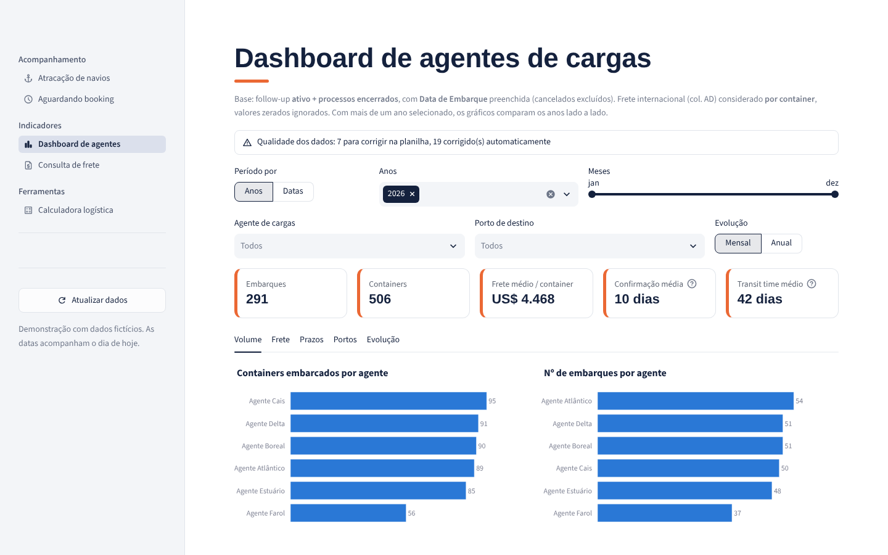
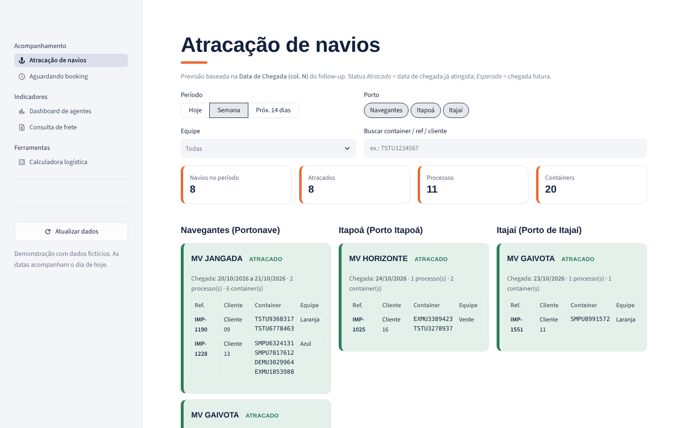
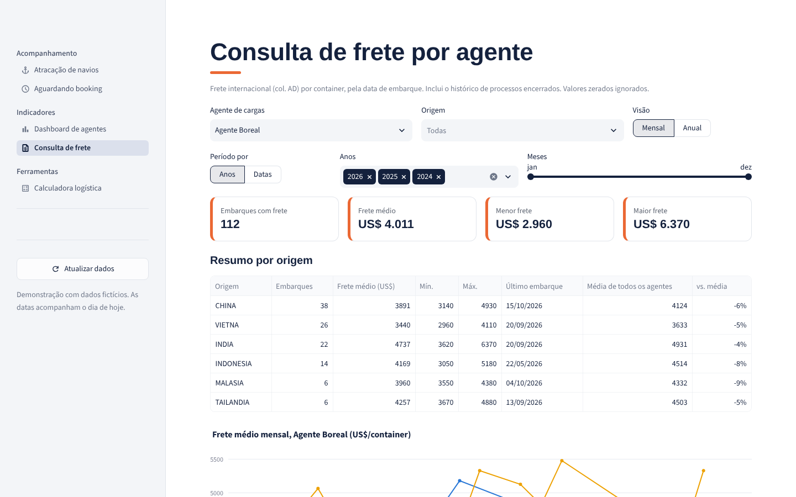

# Painel logístico

  

Plataforma de indicadores logísticos para acompanhamento das operações de importação.

<table>
<tr>
<td width="50%"> Atracação de navios por porto</td>
<td width="50%"> Consulta de frete por agente e origem</td>
</tr>
</table>

## Problema

A diretoria precisava acompanhar semanalmente o cenário logístico: oscilação dos valores de frete, parceiros com maior volume de embarques e cargas com embarque pendente. Os dados estavam distribuídos nas planilhas de follow-up das equipes, sem um meio adequado de consolidação e visualização.

## Lógica

- **Fonte única, sem retrabalho.** As equipes continuam preenchendo o follow-up como antes. O painel apenas lê essas planilhas, sem criar uma segunda base de dados.
- **Tratamento antes da análise.** Grafias diferentes de um mesmo local são unificadas, datas digitadas com erro são corrigidas quando a intenção é clara e registros inválidos são separados para conferência.
- **Indicadores orientados à decisão:** volume por agente de carga e por porto, chegada de navios, cargas aguardando embarque, frete médio por origem e agente, e comparativo entre períodos.
- **Simulação de custos.** Uma calculadora estima armazenagem, serviços do parceiro e frete rodoviário a partir de uma tabela de tarifas mantida pela própria equipe.
- **Relatório para apresentação.** Cada tela gera um PDF com os filtros aplicados.

> Todos os dados exibidos são fictícios.

## Tecnologias

Python, Streamlit, pandas, Plotly, matplotlib e Google Sheets API.
